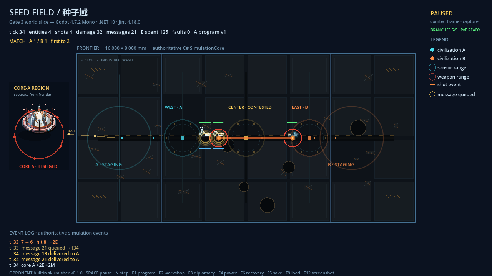

<div align="center">

<h1>Seed Field · 种子域</h1>

<p><strong>可编程二维数字文明沙盒</strong> · <strong>A programmable 2D civilization sandbox</strong></p>

<p>
  
  
  
  
  
</p>

<p>
  <a href="https://github.com/Zn070515/SeedField/actions/workflows/ci.yml"></a>
  <a href="https://github.com/Zn070515/SeedField/actions/workflows/dependency-review.yml"></a>
</p>

<p>
  <a href="#项目现状">项目现状</a> ·
  <a href="#工程结构">工程结构</a> ·
  <a href="#快速开始">快速开始</a> ·
  <a href="#文档入口">文档入口</a> ·
  <a href="#工程原则">工程原则</a>
</p>

</div>

玩家在中央主控崩溃已久的二维数字世界中，从不可摧毁的种子核心区出发，通过元件构造、JavaScript 编程、能源与物资网络和自主设备，建立可持续运行的数字文明，并与其他玩家留下的**离线文明版本**在同一套规则下探索、合作与竞争。

完整游戏离线可玩，不依赖开发者服务器；设计基线为 V1.9 Rev2。本仓库是正式工程，不是设计资料包。

<p align="center"></p>

## 项目现状

| 项目 | 说明 |
|---|---|
| 当前里程碑 | **M0 纵切片**：Headless 可复现 + Godot 真实画面，均由同一 C# 仿真与 JS 控制器驱动 |
| 仿真核心 | 固定 Tick、意图归属/可见性校验、观察过滤、E/M、通信、直接交火、核心区保护与保底复建 |
| 程序闭环 | **游戏内编辑 A 方 JavaScript → 热部署 → 观察行为变化**；编译失败保留旧版本 |
| 成长/工坊 | 五分支最低可用判定、蓝图版本 → 部署实例（扣本地 M）、显式升级、核心区最新产品登记 |
| 多区域 | 显式区域链路、双向 BFS（扩展较小 frontier）、跨区延迟、链路带宽、存档往返 |
| 跨区物流 | 多跳链路运输 M，途中不可用，按路径总延迟到达；链路物资容量可限制 |
| 跨区能源 | 区域电网库存；实体可存入/抽取；跨区运输带延迟与链路能源容量 |
| 区域加载 | 引擎级活动区域：非活动区拒绝意图，被动系统继续运行；活动集不写入存档 |
| 设备级知识 | 每实体独立观察/控制器；只感知本设备传感器与目标区域消息；不再文明级融合 |
| 工程收口 | 统一部署/升级命令、存档 schema v2 + v1 迁移、摧毁库存损失审计 |
| PvE 目标 | 多控制点：独占驻留、争夺重置、占领数量达到阈值即胜负；HUD 与胜利截图 |
| 通信/对手 | 跨文明消息要求目标区 Comm 端点 + 目标文明策略允许；内置对手包可选并持久化 |
| 消息 ACL | 发送方/话题白名单、黑名单优先；引擎派生发送者；重复消息 ID 拒绝；断联不扣能量 |
| 条约/贸易 | 互不侵犯/贸易协定；宿主命令签约；互不侵犯阻止攻击；贸易托管、原子交换与退款；反提议最多 3 轮；存档 v8 |
| 对手外交 | B 按画像主动提议/下单并响应 A：Skirmisher 拒绝 NAP、要求贸易利润；Turtle 接受 NAP/公平贸易；反提议逐轮让步 |
| 电力网络 | 发电溢出入网、自动取电/储备、容量上限、优先级负载切除、延迟/损耗净额补偿、持久断路器与 F4 面板；存档 v11 |
| 建造/恢复 | `BuildTicks` 队列、工坊 UI、取消/失败退款；核心区恢复统一命令入口 |
| 区域加载 | 非活动区跳过发电并在激活/保存前补算；消息/物流/核心再生继续 |
| 客户端 | **Godot 4.7.2 Mono 可视切片 + 程序编辑器 + 工坊 + 外交/电网面板（net10.0）** |
| 验证 | 177 个仿真测试 + 48 个 Jint 测试通过；600 Tick 双跑哈希一致；战斗/编辑器/工坊/外交/电网/胜利截图已提交；CI 构建/测试/提交规范 |
| 技术栈 | .NET 10.0 / C# / JavaScript + Jint 4.18.0 / Godot 4.7.2 .NET |

## 工程结构

| 层 | 目录 | 职责 |
|---|---|---|
| 设计基线 | [`docs/design-bible/v1.9-rev2`](docs/design-bible/v1.9-rev2) | 产品、玩法、技术、路线图与决策登记 |
| 工程文档 | [`docs/engineering`](docs/engineering) | 实现基线、ADR、验收证据 |
| 仿真核心 | [`src/SeedField.Simulation`](src/SeedField.Simulation) | 唯一权威 `WorldState`、Tick、验证、事件、哈希 |
| 脚本运行时 | [`src/SeedField.Runtime.Js`](src/SeedField.Runtime.Js) | Jint 4.18.0；JSON 进/JSON 出，不暴露 CLR |
| Headless | [`src/SeedField.Headless`](src/SeedField.Headless) | 双文明纵切片 Runner |
| 客户端 | [`game/SeedField.Game`](game/SeedField.Game) | Godot 4.7.2 Mono 可视切片、程序编辑器与工坊；只渲染 `SimulationEvent` |

## 快速开始

```powershell
pwsh tools/setup-git-hooks.ps1
dotnet build SeedField.slnx
dotnet test SeedField.slnx
dotnet run --project src/SeedField.Headless/SeedField.Headless.csproj
dotnet run --project src/SeedField.Headless/SeedField.Headless.csproj -- --multi-region
dotnet run --project src/SeedField.Headless/SeedField.Headless.csproj -- --logistics
dotnet run --project src/SeedField.Headless/SeedField.Headless.csproj -- --energy
dotnet run --project src/SeedField.Headless/SeedField.Headless.csproj -- --region-load
dotnet run --project src/SeedField.Headless/SeedField.Headless.csproj -- --construction
dotnet run --project src/SeedField.Headless/SeedField.Headless.csproj -- --construction-cancel
dotnet run --project src/SeedField.Headless/SeedField.Headless.csproj -- --message-acl
dotnet run --project src/SeedField.Headless/SeedField.Headless.csproj -- --diplomacy
dotnet run --project src/SeedField.Headless/SeedField.Headless.csproj -- --diplomacy-ai
dotnet run --project src/SeedField.Headless/SeedField.Headless.csproj -- --diplomacy-negotiation
dotnet run --project src/SeedField.Headless/SeedField.Headless.csproj -- --power-grid
dotnet run --project src/SeedField.Headless/SeedField.Headless.csproj -- --power-recovery
dotnet run --project src/SeedField.Headless/SeedField.Headless.csproj -- --power-limits
dotnet run --project src/SeedField.Headless/SeedField.Headless.csproj -- --power-breaker
dotnet run --project src/SeedField.Headless/SeedField.Headless.csproj -- --power-maintenance
dotnet run --project src/SeedField.Headless/SeedField.Headless.csproj -- --power-fault
dotnet run --project src/SeedField.Headless/SeedField.Headless.csproj -- --recovery-quota
dotnet run --project src/SeedField.Headless/SeedField.Headless.csproj -- --core-siege
dotnet run --project src/SeedField.Headless/SeedField.Headless.csproj -- --wrecks
dotnet run --project src/SeedField.Headless/SeedField.Headless.csproj -- --combat-rng
dotnet run --project src/SeedField.Headless/SeedField.Headless.csproj -- --replay-record replay.json
dotnet run --project src/SeedField.Headless/SeedField.Headless.csproj -- --replay-play replay.json
dotnet run --project src/SeedField.Headless/SeedField.Headless.csproj -- --region-scale
dotnet run --project src/SeedField.Headless/SeedField.Headless.csproj -- --sandbox-check
dotnet run --project src/SeedField.Headless/SeedField.Headless.csproj -- --worker-opponent-appcontainer
dotnet run --project src/SeedField.Headless/SeedField.Headless.csproj -- --ruins
dotnet run --project src/SeedField.Headless/SeedField.Headless.csproj -- --worker-opponent
dotnet run --project src/SeedField.Headless/SeedField.Headless.csproj -- --package-check <dir> --allow-unsigned --confirm
dotnet run --project src/SeedField.Headless/SeedField.Headless.csproj -- --benchmark-jint 100
dotnet run --project src/SeedField.Headless/SeedField.Headless.csproj -- --benchmark-jint-parallel 100
dotnet run --project src/SeedField.Headless/SeedField.Headless.csproj -- --benchmark-startup 1000

godot --path game/SeedField.Game                      # 实时；F1 程序，F2 工坊，F3 外交，F4 电网，F6 恢复
godot --path game/SeedField.Game -- --capture         # 战斗截图
godot --path game/SeedField.Game -- --capture-editor  # 程序编辑器截图
godot --path game/SeedField.Game -- --capture-workshop # 工坊截图
godot --path game/SeedField.Game -- --capture-diplomacy # 外交面板截图
godot --path game/SeedField.Game -- --capture-diplomacy-ai # B 方外交响应截图
godot --path game/SeedField.Game -- --capture-power    # 电网诊断截图
godot --path game/SeedField.Game -- --capture-recovery # 核心恢复面板截图
godot --path game/SeedField.Game -- --capture-victory  # 控制点占领截图
godot --path game/SeedField.Game -- --diplomacy-smoke  # 外交面板按钮接线冒烟
godot --path game/SeedField.Game -- --diplomacy-ai-smoke # B 方自动响应冒烟
godot --path game/SeedField.Game -- --diplomacy-counter-smoke # 面板反提议接线冒烟
godot --path game/SeedField.Game -- --power-breaker-smoke # 面板断路器接线冒烟
godot --path game/SeedField.Game -- --recovery-smoke  # 恢复面板 RECOVER/MAINTAIN 接线冒烟
godot --path game/SeedField.Game -- --opponent-turtle  # 使用 Turtle 内置对手
```

Godot 客户端建议以 `DOTNET_gcServer=1` 启动（多控制器并行时需要 Server GC）；
Headless 已在项目文件中启用。

Headless Runner 运行 600 Tick 双文明对战并验证哈希；Godot 切片渲染同一套仿真事件。

## 文档入口

| 文档 | 内容 |
|---|---|
| [`IMPLEMENTATION_BASELINE.md`](docs/engineering/IMPLEMENTATION_BASELINE.md) | 已确认规则、真实代码状态、风险与下一步 |
| [`CONTRIBUTING.md`](CONTRIBUTING.md) | 分支、提交格式、验证门禁与 PR 流程 |
| [`ENGINEERING_STANDARDS.md`](docs/engineering/ENGINEERING_STANDARDS.md) | 权威来源、确定性、schema、依赖与发布标准 |
| [`TESTING.md`](docs/engineering/TESTING.md) | 分层测试、黄金场景、不变量 fuzz 与结构门禁 |
| [Art vertical slice](art/README.md) | A/B 相机、8 方向工体、核心四态、模块替换、mask 与性能证据 |
| [`docs/art/`](docs/art/VISUAL_LANGUAGE_V0_1.md) | ChatGPT Art-DeepPush 视觉语言/管线/验收参考 |
| [`DECISION_REGISTER.md`](docs/design-bible/v1.9-rev2/00-START-HERE/DECISION_REGISTER.md) | CONFIRMED / BASELINE / OPEN 决策主索引 |
| [`ADR-0001`](docs/engineering/adr/ADR-0001-dotnet10-runtime-target.md) | .NET 10.0 运行时目标 |
| [`evidence/`](docs/engineering/evidence/2026-11-16-m0-headless-slice.md) | Headless 测试、哈希与运行证据 |
| [`visual slice`](docs/engineering/evidence/2026-11-16-godot-visual-slice.md) | Godot 画面、截图与 net10.0 运行证据 |
| [`program deployment`](docs/engineering/evidence/2026-11-16-program-deployment.md) | 游戏内 JS 编辑、热部署与失败回退证据 |
| [`workshop & economy`](docs/engineering/evidence/2026-11-16-workshop-and-economy.md) | 蓝图/实例/升级、五分支、存档与 E/C/B 约束证据 |
| [`multi-region`](docs/engineering/evidence/2026-11-16-multi-region.md) | 区域链路、BFS 路由、跨区延迟与链路带宽证据 |
| [`material logistics`](docs/engineering/evidence/2026-11-16-material-logistics.md) | 跨区材料运输、在途与到达证据 |
| [`cross-region energy`](docs/engineering/evidence/2026-11-16-energy-grid.md) | 区域电网、抽取/存入、跨区运输证据 |
| [`region activation`](docs/engineering/evidence/2026-11-16-region-activation.md) | 活动区域、意图 gating 与被动系统连续性证据 |
| [`semantic review`](docs/engineering/reviews/2026-11-16-semantic-review.md) | 实现 vs 设计基线的语义审查与未闭合缺口 |
| [`core protection`](docs/engineering/evidence/2026-11-16-core-protection.md) | 外文明部署/行动拒绝与存档校验证据 |
| [`review closeout`](docs/engineering/evidence/2026-11-16-semantic-review-closeout.md) | 设备级知识、部署命令、存档 v2、资源损失收口证据 |
| [`control point`](docs/engineering/evidence/2026-11-16-control-point.md) | 控制点占领、争夺重置与胜利截图证据 |
| [`four-track batch`](docs/engineering/evidence/2026-11-17-four-track-batch.md) | 跨文明通信、内置对手、恢复命令、建造队列证据 |
| [`cancel & opponents`](docs/engineering/evidence/2026-11-17-cancel-and-opponents.md) | 取消退款、对手选择与协议边界证据 |
| [`persistence & queue UI`](docs/engineering/evidence/2026-11-17-persistence-and-queue-ui.md) | 对手元数据存档、建造队列 UI 证据 |
| [`policy/refund/offscreen`](docs/engineering/evidence/2026-11-17-policy-refund-offscreen.md) | 消息权限、失败退款、离屏发电预算证据 |
| [`message ACL`](docs/engineering/evidence/2026-11-17-message-acl.md) | 发送方/话题白名单、身份边界、重复消息与断联证据 |
| [`treaty & trade`](docs/engineering/evidence/2026-11-17-treaty-trade.md) | 互不侵犯、贸易托管/原子交换/退款、存档 v7 证据 |
| [`diplomacy panel`](docs/engineering/evidence/2026-11-17-diplomacy-panel.md) | F3 外交面板、按钮接线、截图与 smoke 证据 |
| [`opponent diplomacy`](docs/engineering/evidence/2026-11-17-opponent-diplomacy.md) | B 方画像化自动响应、Headless/Godot 证据与截图 |
| [`negotiation`](docs/engineering/evidence/2026-11-17-negotiation.md) | 主动提议、多轮反提议、回合上限与让步证据 |
| [`power grid`](docs/engineering/evidence/2026-11-17-power-grid.md) | 自动潮流、断供诊断、F4 面板与存档 v9 证据 |
| [`power recovery`](docs/engineering/evidence/2026-11-17-power-recovery.md) | 溢出入网、自动取电/储备、潮流延迟损耗与 v10 证据 |
| [`power limits & breaker`](docs/engineering/evidence/2026-11-17-power-limits-breaker.md) | 容量、优先级、净额补偿、持久断路器与 v11 证据 |
| [`power maintenance`](docs/engineering/evidence/2026-11-17-power-maintenance.md) | 抢占式取电、跳闸维护锁定、F4 MAINTAIN 与 v12 证据 |
| [`deterministic random`](docs/engineering/evidence/2026-11-17-deterministic-random.md) | SplitMix64 世界随机流、随机断路器故障与 v13 证据 |
| [`code review medium`](docs/engineering/reviews/2026-11-17-code-review-medium.md) | 审查 8 项修复、2 项保留与回归测试 |
| [`offline package security`](docs/engineering/security/2026-11-17-offline-package-threat-model.md) | 离线文明包威胁模型、隔离架构与 12 项开放门禁 |
| [`worker isolation`](docs/engineering/evidence/2026-11-17-worker-isolation.md) | Phase 1 工作进程、IPC、Job Object 与双跑哈希证据 |
| [`package trust`](docs/engineering/evidence/2026-11-17-package-trust.md) | 签名包、信任存储、显式同意、CPU/磁盘限额与 IPC fuzz 证据 |
| [`recovery quota`](docs/engineering/evidence/2026-11-17-recovery-quota.md) | 恢复配额、恢复债务、慢速模式与 v14 证据 |
| [`core shell & siege`](docs/engineering/evidence/2026-11-17-core-shell-siege.md) | 外壳锚点、覆盖缺口、围困成本/配额与 v15 证据 |
| [`device wrecks`](docs/engineering/evidence/2026-11-17-device-wrecks.md) | 设备残骸、原主/在场回收、v16 证据 |
| [`ruin snapshots`](docs/engineering/evidence/2026-11-17-ruin-snapshots.md) | 本地离线快照、切片/老化/掠夺、数据-only 校验 |
| [`recovery panel`](docs/engineering/evidence/2026-11-17-recovery-panel.md) | F6 配额/债务/锚点/围困面板、核心维护与 v17 证据 |
| [`art vertical slice`](docs/engineering/evidence/2026-11-17-art-vertical-slice.md) | A/B 相机、Blender 资产、Godot 层叠/缩放截图与资产门禁 |

## 工程原则

| 规则 | 要求 |
|---|---|
| 单一真实状态源 | 只有 `SimulationCore` 修改世界；UI、Shader、脚本只能读观察、提交意图 |
| 固定 Tick 可复现 | 整数坐标、稳定 ID/事件顺序；不以 FPS 或真实 CPU 毫秒结算 |
| 离线优先 | 无账号、匹配、遥测、云推理或自建游戏服务器 |
| 核心区不可毁 | 外部全毁后必须能在有限步骤内复建最低实体 |
| 不可信脚本 | Jint 限制不是 OS 沙箱；未完成进程隔离前不开放第三方包执行 |
| 证据导向 | 不把未执行的测试、未验证的画面或演示数值写成已确认结论 |
| 篇幅受控 | 单个 `.cs` / `.md` ≤ 600 行；`SeedField.Repository.Tests` 自动失败超限文件 |

## 当前限制

Godot 画面仍是原型绘制；区域活动只是意图 gating（ADR-0004）；文明级 legacy 观察 API 仍保留给工具；核心区恢复已有统一配额、恢复债务、外壳锚点与围困成本/配额压力，已有残骸占领/封锁他方回收与锚点仓储/产出加成，但锚点独立蓝图/多跳围困、残骸老化/掠夺、独立废墟美术、快照签名/Workshop 流程未做；电网已有溢出入网、自动取电/储备、容量上限、抢占式优先级、延迟/损耗净额补偿、持久断路器、维护锁定与可复现随机故障，但无维护时长，也没有多电压/潮流方程；战斗已有确定性随机命中/伤害/掉落与 Intent 边界回放；跨文明协议已有 ACL/条约/贸易/外交面板/多轮反提议，但混合资源反提议、议价记忆、信誉/关税与消息签名仍未实现；PvE 对手已有内置包、Phase 1 工作进程隔离、Phase 2a 签名/同意/CPU/磁盘限额与 Phase 2b AppContainer 网络/文件隔离，但 OS 磁盘配额（当前无可写文件面）、发布签名密钥/Workshop、独立安全审查、第三方可执行包导入、导出模板与正式平衡数值仍未完成。详细风险见[实现基线](docs/engineering/IMPLEMENTATION_BASELINE.md)。
