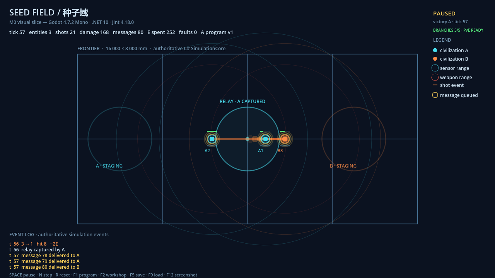

# 证据：控制点 PvE 目标（2026-11-16）

## 实现

- `ControlPointState`：单点、区域、位置、半径、驻留 Tick、当前占领文明、进度、owner。
- 每个 Step 结算：
  - 只有**唯一文明**的实体在圈内时累计进度；
  - 争夺（多文明）或无人在圈内 → 进度清零；
  - 达到 `HoldTicksRequired` → `ControlPointCaptured`，记录 owner。
- 控制点进入世界哈希、存档与加载校验；设备观察只向同区域设备暴露。
- Godot HUD 绘制控制圈、当前占领/进度/争夺状态；`--capture-victory` 跑到占领后截图。

## 构建与测试

```powershell
dotnet build SeedField.slnx
dotnet test SeedField.slnx
```

```text
SeedField.Simulation.Tests: 84 passed
SeedField.Runtime.Js.Tests: 17 passed
```

新增覆盖：

| 用例 | 断言 |
|---|---|
| 独占驻留 | 3 Tick 后 owner=A，事件产生 |
| 争夺 | 进度保持 0，不产生 owner |
| 离开半径 | 已有进度清零 |
| 存档 | 进度/owner 保留，加载后继续累计 |
| 设备观察 | 同区域设备能看到控制点 |

## Godot 实测

```powershell
godot --path game/SeedField.Game -- --capture-victory
```

```text
tick 57  victory A
RELAY · A CAPTURED
```



## 未覆盖

- 多控制点、区域级胜负、外交/投降。
- 控制点被争夺后的衰减/锁定规则。
- 目标是否应始终对全文明可见（当前只对同区域设备可见）。
