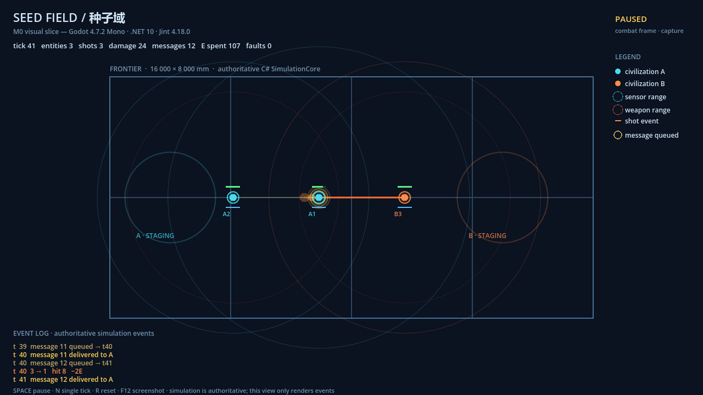

# 证据：Godot M0 可视切片（2026-11-16）

## 环境

```text
Godot 4.7.2.stable.mono.official.ed1daf0bf
OpenGL 3.3 / NVIDIA GeForce RTX 4090 / 驱动 610.62
.NET SDK 10.0.404
```

## 构建

```powershell
dotnet build game/SeedField.Game/SeedField.Game.csproj
# exit 0
```

工程：`Godot.NET.Sdk/4.7.2`，`TargetFramework=net10.0`，引用 `SeedField.Simulation` 与 `SeedField.Runtime.Js`。

## 运行与截图

```powershell
godot --path game/SeedField.Game -- --capture
```

输出：

```text
Godot Engine v4.7.2.stable.mono.official.ed1daf0bf
OpenGL API 3.3.0 NVIDIA 610.62 - Compatibility - Using Device: NVIDIA - NVIDIA GeForce RTX 4090

SEEDFIELD_READY args=--capture
SEEDFIELD_PRERUN tick=41 shots=3 entities=3
SCREENSHOT_SAVED .../game/SeedField.Game/screenshots/m0-combat.png (Ok)
```

连续运行 180 帧（`--quit-after 180`）无异常退出：

```text
SEEDFIELD_READY args=
SEEDFIELD_PRERUN tick=41 shots=3 entities=3
```

## 截图



画面内容：

- 1280 × 720，16 000 × 8 000 mm 的单一区域，1 000 mm 网格。
- 文明 A（青色）实体 A1 侦察 / A2 火力；文明 B（橙色）实体 B3 火力。
- 传感器与武器射程环、生命/能量条。
- 射击事件轨迹与命中闪光，来自 `ShotFired` 事件。
- 消息脉冲与同文明链路提示，来自 `MessageQueued` 事件。
- 事件日志、Tick、射击/伤害/消息/能耗统计。
- 两个单位均由**真实 Jint 脚本**驱动；Godot 未运行第二套战斗逻辑。

预跑在 Tick 41、第 3 次射击时暂停并截图；HUD 显示 `shots 3 / damage 24 / messages 12 / E spent 107 / faults 0`。

## 覆盖的验收点

| 验收点 | 证据 |
|---|---|
| Godot 运行真实仿真事件 | 截图中的实体、射程、弹道、伤害均来自 C# 事件 |
| 真实 JS 控制器驱动画面 | A/B 控制器使用与 Headless 相同的 `decide(observation)` 契约 |
| net10.0 客户端可构建运行 | `dotnet build` + Godot OpenGL 运行 |
| 画面可解释 | Tick、统计、射击/消息/摧毁事件日志 |
| 无第二套仿真 | `Main.cs` 只读取 `WorldState` 与事件，不修改它 |

## 未覆盖

- 正式美术、动画、音效、相机与完整 UI。
- 核心区视觉、多区域、跨区网络。
- 导出 Windows 包（未装导出模板）。
- 真人可玩性验证。
