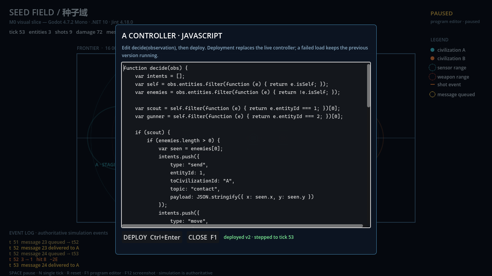

# 证据：游戏内 JavaScript 编辑与热部署（2026-11-16）

## 环境

```text
Godot 4.7.2.stable.mono.official.ed1daf0bf
.NET SDK 10.0.404
Jint 4.18.0
OpenGL 3.3 / NVIDIA GeForce RTX 4090
```

## 实现

- `SeedField.Runtime.Js.ControllerSlot`：持有一个 `JsController` 与版本号。
  - `Deploy(script)` 先在隔离的新 Jint 引擎中编译脚本；成功才原子替换，旧实例释放。
  - 编译/加载失败返回 `Success=false`，旧控制器与旧版本继续工作。
- Godot `ProgramEditor`：`F1` 打开，`Ctrl+Enter` 部署；错误显示在状态栏。
- 编辑器打开时暂停；关闭后继续，符合“工坊/代码编辑默认暂停”。

## 构建与测试

```powershell
dotnet build SeedField.slnx
dotnet test SeedField.slnx
```

结果：

```text
SeedField.Simulation.Tests: 19 passed
SeedField.Runtime.Js.Tests: 10 passed
```

新增 `ControllerSlotTests`：

| 用例 | 断言 |
|---|---|
| 成功部署 | 行为从 wait 变为 move，版本 1→2 |
| 失败部署 | 返回失败，版本不变，旧控制器仍返回 wait |
| 脚本保留 | `DeployedScript` 保存新脚本，供存档/重显 |

## 运行与截图

```powershell
godot --path game/SeedField.Game -- --capture-editor
```

输出：

```text
SEEDFIELD_READY args=--capture-editor
SEEDFIELD_PRERUN tick=41 shots=3 entities=3
SCREENSHOT_SAVED .../screenshots/m0-program-editor.png (Ok)
```

编辑器模式把 A 方交战阈值 `3500 → 4200`，部署为 v2，并推进 12 Tick：

```text
deployed v2 · stepped to tick 53
```



## 覆盖的验收点

| 验收点 | 证据 |
|---|---|
| 玩家可在游戏内编辑程序 | F1 编辑器截图，代码来自实际 `TextEdit` |
| 部署后行为可变化 | 射程阈值修改并部署 v2，模拟继续推进 |
| 坏程序不能拖坏世界 | 部署失败保留旧控制器；3 个单元测试 |
| 编辑器默认暂停 | 打开时 `_paused=true`，HUD 显示 PAUSED |
| Godot 不执行第二套逻辑 | 部署只替换 Jint 控制器，世界仍由 C# 核心结算 |

## 未覆盖

- 程序版本写入存档、重启恢复。
- 蓝图/多设备共享同一程序版本。
- 编辑器语法高亮、自动补全与 `.d.ts`。
- 部署到第三方离线文明包（安全隔离未完成）。
