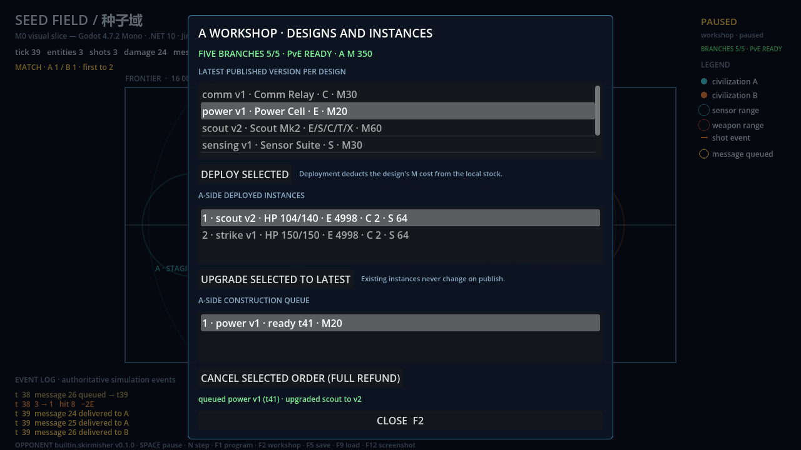

# 证据：工坊、蓝图版本、存档与 E/C/B 约束（2026-11-16）

## 构建与测试

```powershell
dotnet build SeedField.slnx
dotnet test SeedField.slnx
```

```text
SeedField.Simulation.Tests: 95 passed
SeedField.Runtime.Js.Tests: 13 passed
```

新增覆盖：

| 领域 | 用例 |
|---|---|
| 蓝图/实例 | 发布 v2 不改已部署实例；显式升级；未发布蓝图不可部署 |
| 五分支 | 能源/感知/通信/状态/执行全部覆盖才 `IsMinimumUsable` |
| 核心区 | 每分支登记最新产品；存档后可从核心区恢复 |
| 存档 | 世界/在途消息/核心区/蓝图/统计往返哈希一致；拒绝未知 schema |
| E/C/B | 本地发电封顶；算力预算拒绝第二个意图；带宽拒绝第二条消息 |
| 控制器 | 保存脚本与版本；坏脚本读取失败 |

## Godot 运行

```powershell
godot --path game/SeedField.Game -- --capture-workshop
godot --path game/SeedField.Game -- --save-smoke
```

输出：

```text
SEEDFIELD_PRERUN tick=41 shots=3 entities=3
SCREENSHOT_SAVED .../screenshots/m0-workshop.png (Ok)

SAVE_SMOKE ok=True before=5c8feee79428c134 mutated=c1bf1ef2c9b77030 after=5c8feee79428c134 tick=39 A=v1 B=v1
```



画面内容：

- `FIVE BRANCHES 5/5 · PvE READY`：蓝图注册表覆盖全部五个分支。
- 每个设计列出最新版本、分支标签（E/S/C/T/X）与 M 成本。
- A 侧三个实例：Scout Mk2（由 v1 显式升级）、Strike Frame、Power Cell；面板显示 C/S 能力与本地 M 库存。
- 部署与升级都由 `SimulationCore` 执行；Godot 只发请求并显示结果。
- 部署从区域本地 M 库存扣费（面板显示 `A M 350`）；不足时拒绝。
- 收件箱容量取己方 `StateModule.StorageCapacity` 之和；超限时最旧消息过期。

## 存档行为

- `WorldSaveSerializer`：区域、实体、蓝图注册表、核心区最新产品、在途消息、收件箱、统计与下一 ID。
- `GameSaveSerializer`：在外层追加 A/B 控制器脚本与版本。
- `F5`/`F9` 落盘 `user://seedfield-save.json`；读取失败保留当前世界。
- `--save-smoke` 证明保存、推进 10 Tick、读取后哈希回到保存点。

## 未覆盖

- 多区域、跨区通信/物流。
- 制造队列与生产时间。
- 存储容量为 0 时的产品规则（当前按“无历史”处理）。
- 旧存档迁移（当前仅 schema v1）。
- 正式美术与导出包。
